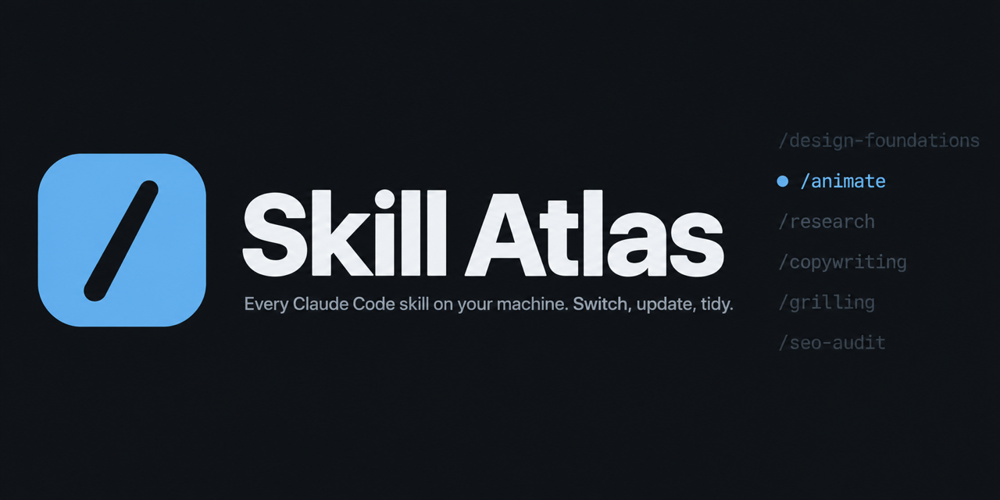
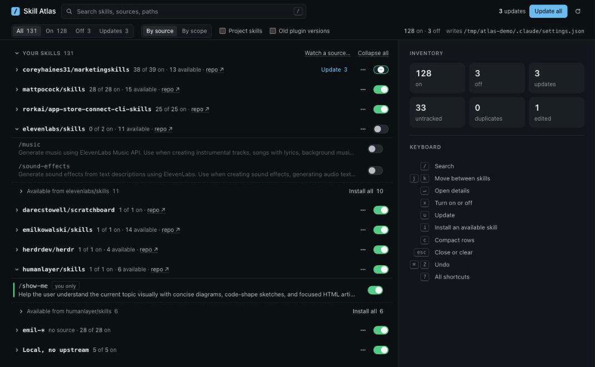

<p align="center">
  
</p>

<p align="center">
  <a href="https://github.com/darecstowell/skill-atlas/actions/workflows/ci.yml"></a>
  
  
  <a href="LICENSE"></a>
</p>

Skill Atlas shows every Claude Code skill on your machine on one local page. You can turn skills
on and off, update them from GitHub, install new skills from the repos you follow, and move old
skills to the Trash.

<p align="center">
  
</p>

## Quick start

```bash
git clone https://github.com/darecstowell/skill-atlas.git
cd skill-atlas
./atlas
```

`./atlas` starts a server on `127.0.0.1:7381` and opens the page. It needs Python 3.10 or later and
nothing else. For a short command, add an alias:

```bash
alias atlas='~/path/to/skill-atlas/atlas'
```

## What it does

| | |
| --- | --- |
| **See everything** | Personal, plugin, and project skills in one list, grouped by the repo they came from. Search covers names, descriptions, sources, and paths. |
| **Switch skills on and off** | One switch per skill, per source, or per plugin. Changes go to `settings.json`, with a backup made first. |
| **Update from GitHub** | Marks skills whose upstream folder changed. Update one skill, one source, or all. About 40 skills update in 3 seconds. |
| **Find new skills** | Lists the skills a source repo has that you have not installed, and tags the ones added since you last looked. |
| **Read a skill** | Press `v` to open the whole SKILL.md in a large reader, formatted or as raw Markdown, with a section outline. |
| **See where it comes from** | Each source shows its owner's GitHub avatar. A source's panel shows the repo's banner, and a skill's panel shows a picture from its own folder when it has one. |
| **List or cards** | Switch between dense rows and a card grid. Pick light, dark, or the system theme. |
| **Tidy up** | Delete moves a skill to the Trash, with Undo. A **same as** tag marks skills with the same description. |

## How it works

**Sources.** A skill is tracked when it has a GitHub source in `~/.agents/.skill-lock.json`
(written by `npx skills`) or in `~/.agents/.atlas-lock.json` (written by **Link to GitHub…**).
Untracked skills that share a name prefix, such as `emil-*`, get their own group.

**Update checks.** On load, the atlas reads each source repo's file tree from GitHub (through `gh`,
then anonymous HTTPS). A skill is out of date when its folder SHA is different from the SHA in the
lock. Results stay in a cache for 10 minutes; **Check again** refreshes them.

**Updates and installs.** The atlas downloads one tarball per repo, swaps each skill folder through
a staged copy, and writes the new SHA back to the lock. `npx skills` stays in step.

**Local edits are safe.** A skill whose folder no longer matches its lock is tagged **edited**.
Batch updates skip it. Its own Update button asks first, because an update replaces the whole
folder.

**New skills.** The first check of a repo records a baseline. After that, skills added upstream
get a **new** tag. **Dismiss** clears the tag. **Watch a source…** follows a repo that has none of
its skills installed yet.

## Switches

| Switch | Writes | Scope |
| --- | --- | --- |
| Skill | `skillOverrides` in `settings.json` | One personal skill |
| Source | `skillOverrides` for each skill in the group | All skills from one repo |
| Plugin | `enabledPlugins` in `settings.json` | A whole plugin. Plugin skills cannot be turned off one by one. |

When you have more than one config root, the root picker sets which settings file to change.
Restart Claude Code sessions to load a change.

## Keyboard

| Key | Action |
| --- | --- |
| `/` or `⌘K` | Search |
| `j` / `k` | Move between skills |
| `Enter` | Open the detail panel |
| `x` or `Space` | Turn the skill on or off |
| `u` | Update the skill |
| `i` | Install an available skill |
| `v` | Read the whole SKILL.md |
| `r` | Formatted or Markdown, in the reader |
| `g` | List or cards |
| `c` | Compact rows |
| `⌘Z` | Undo the last change |
| `?` | All shortcuts |

## Configuration

No setup is needed. The atlas reads `~/.claude`, and also the folder in `CLAUDE_CONFIG_DIR` when
it is set.

To add project folders, or a second Claude Code config folder, run:

```bash
./atlas init
```

This writes `~/.config/skill-atlas/config.json` with the config folders it finds, and prints it.
Edit it to add `project_roots` or to rename a tab:

```json
{
  "config_roots": { "main": "~/.claude", "work": "~/.claude-work" },
  "project_roots": ["~/code"],
  "project_scan_depth": 3
}
```

The atlas reads `$SKILL_ATLAS_CONFIG` first, then `~/.config/skill-atlas/config.json`, then a
`config.json` next to the code.

| Source | Where |
| --- | --- |
| Personal skills | `<config root>/skills`. Symlinks are resolved, so a skill shared by two roots shows once. |
| Plugin skills | `<config root>/plugins/cache/<marketplace>/<plugin>/<version>/skills` |
| Project skills | `<project root>/**/.claude/skills` and `.agents/skills`, down to `project_scan_depth` |

Bundled skills are inside the Claude Code binary, not on disk, so the atlas cannot list them.

## Safety

- The server binds to `127.0.0.1` only. Each API call must send a token that changes every time
  the server starts, so other web pages cannot call it.
- In `settings.json`, the atlas changes only `skillOverrides` and `enabledPlugins`. It makes a
  one-time backup at `settings.json.atlas-bak` before the first write.
- Deletes go to the Trash (`~/.Trash` on macOS, the freedesktop Trash on Linux), never `rm`.
  Where there is no Trash, delete is not available.
- Plugin skills are not checked for updates.
- The page loads avatars, banners, and the SKILL.md of skills you have not installed straight
  from GitHub, so GitHub sees those requests.

## Without the server

```bash
python3 build.py                        # write a read-only page to out/index.html
python3 build.py --json > skills.json   # print the raw records
```

## Development

The tool uses only the Python standard library. Dev tools run through
[uv](https://docs.astral.sh/uv/):

```bash
uv run ruff check . && uv run ruff format --check . && uv run mypy && uv run pytest
```

| File | Job |
| --- | --- |
| `scan.py` | Reads the config roots and makes one record per skill |
| `serve.py` | Local server and the only writer of `settings.json` |
| `updates.py` | Update checks, updates, installs, and watched sources |
| `assets.py` | Avatars, banners, and image paths for source repos |
| `usage.py` | Counts skill use from Claude Code's counters and session transcripts |
| `remove.py` | Moves skills to the Trash, and puts them back |
| `build.py` | Puts the records into `template/index.html` |
| `template/index.html` | The page: one file of HTML, CSS, and JavaScript |

Read [CONTRIBUTING.md](CONTRIBUTING.md) before you open a pull request.

## License

[MIT](LICENSE)
