<p align="center">
  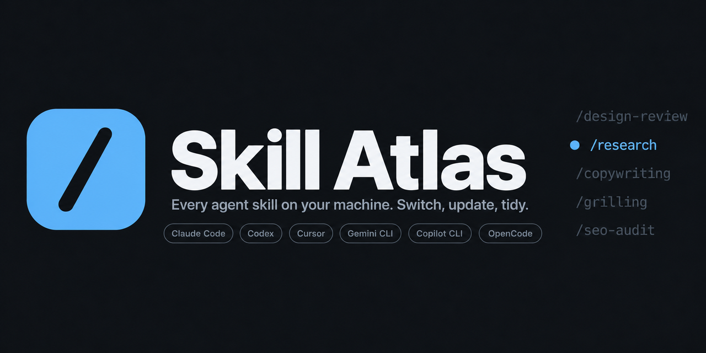
</p>

```bash
uvx --from git+https://github.com/darecstowell/skill-atlas skill-atlas
```

<p align="center">
  <a href="https://github.com/darecstowell/skill-atlas/actions/workflows/ci.yml"></a>
  
  
  <a href="LICENSE"></a>
</p>

Skill Atlas is one local page for every agent skill on your machine. It reads the skills of
Claude Code, Codex, Cursor, Gemini CLI, Copilot CLI, OpenCode, and more. Turn skills on and off for
each harness, update them from GitHub, and find the ones that cost context but never run.

<p align="center">
  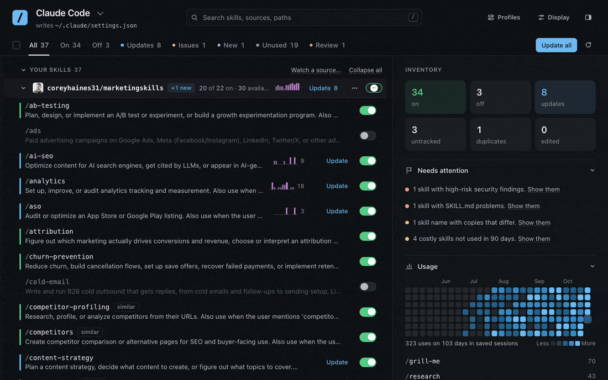
</p>

## Quick start

Skill Atlas needs Python 3.10 or later and nothing else. Use one of these methods. Each one starts
a server on `127.0.0.1:7381` and opens the page.

**Clone and run**

```bash
git clone https://github.com/darecstowell/skill-atlas.git
cd skill-atlas
./atlas
```

For a short command, add an alias: `alias atlas='~/path/to/skill-atlas/atlas'`.

**Run with uv, no clone**

```bash
uvx --from git+https://github.com/darecstowell/skill-atlas skill-atlas
```

**Claude Code plugin**

```text
/plugin marketplace add darecstowell/skill-atlas
/plugin install skill-atlas@skill-atlas
```

Then type `/skills-atlas`. It starts the atlas in the background and shows the URL. It uses `uvx`
when you have it, and the plugin's own copy when you do not.

**Single file**

Download `skill-atlas.pyz` from [Releases](https://github.com/darecstowell/skill-atlas/releases),
then run it:

```bash
python3 skill-atlas.pyz
```

Use `--port` to set a different port, and `--no-open` to keep the browser closed.

## What it does

<table>
<tr><td width="50%" valign="top"><b>Needs attention</b><br>The side panel collects what needs you: high-risk findings, broken SKILL.md files, copies that differ, and costly skills you do not use.<br><br>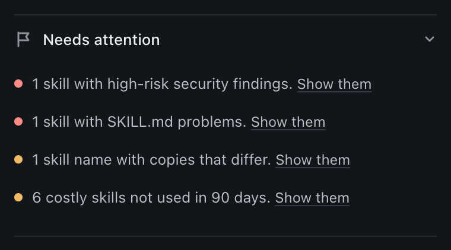</td><td width="50%" valign="top"><b>Switch per harness</b><br>Each harness has its own switch, and the atlas writes it to that harness’s config file after it makes a backup.<br><br>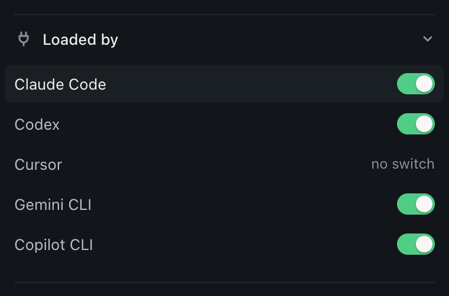</td></tr>
<tr><td width="50%" valign="top"><b>Update from GitHub</b><br>The atlas marks skills whose upstream folder changed, and updates one skill, one source, or all of them.<br><br>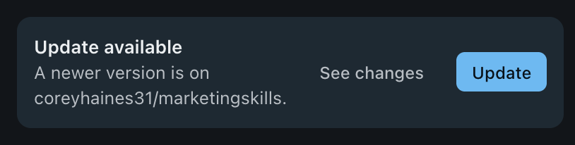</td><td width="50%" valign="top"><b>Find overlap</b><br>The atlas marks skills with descriptions so similar that the agent can load the wrong one, and copies of a skill that differ.<br><br>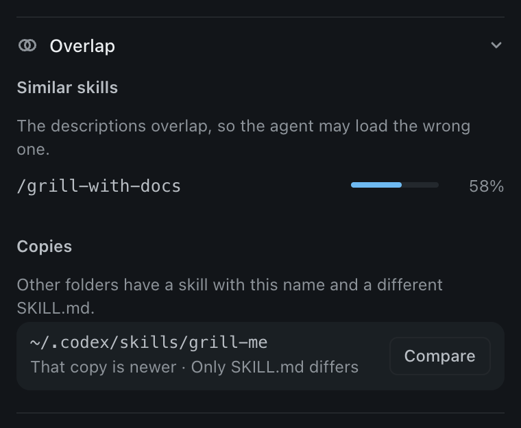</td></tr>
<tr><td colspan="2"><b>See changes, then roll back</b><br>Before an update, see each changed file as a line diff, and after it, <b>History</b> can put back any of the last 5 versions.<br><br>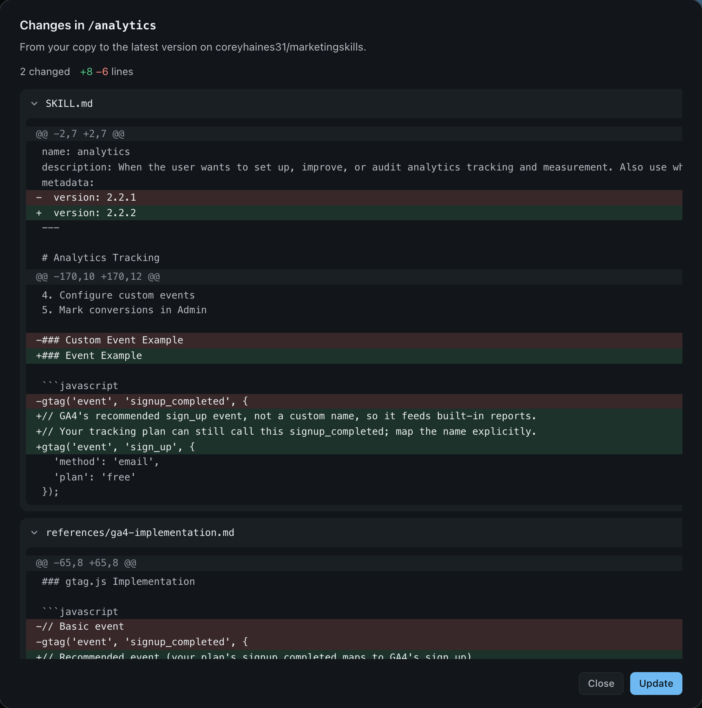</td></tr>
<tr><td width="50%" valign="top"><b>See context cost</b><br>The atlas estimates how many tokens each harness spends in every session to list the skills that are on.<br><br>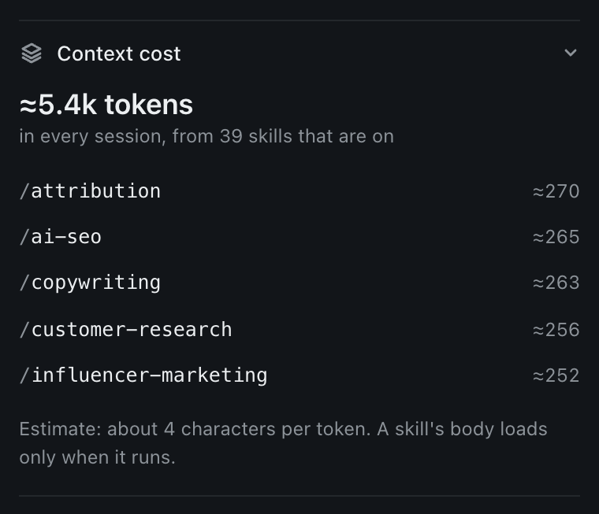</td><td width="50%" valign="top"><b>See what you use</b><br>A heatmap from your session logs shows which skills you use and which you never use.<br><br>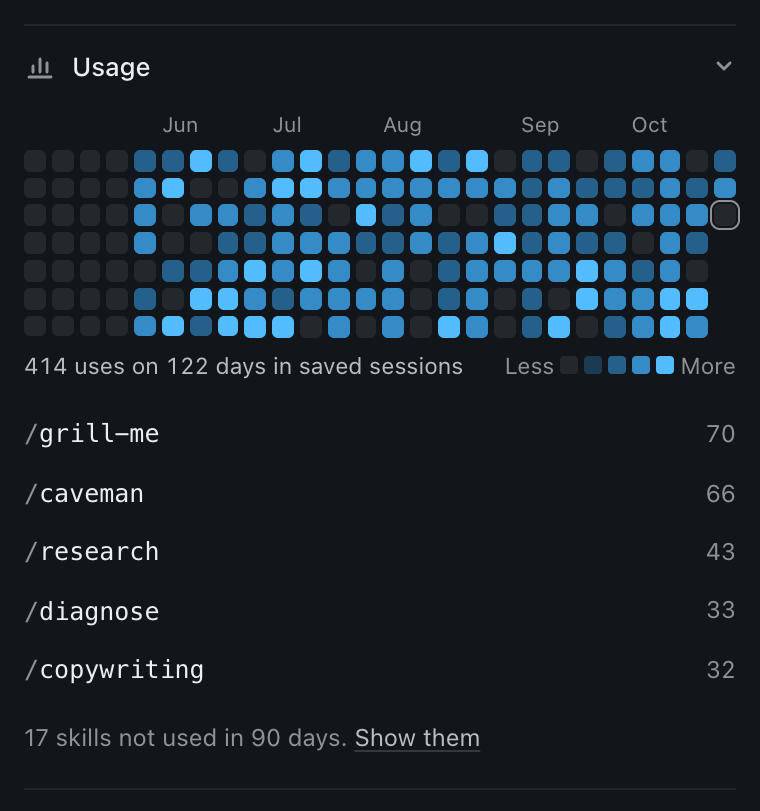</td></tr>
<tr><td width="50%" valign="top"><b>Check before you trust</b><br>A read-only heuristic scan marks skills that run code, pipe a download into a shell, read secrets, or hide instructions.<br><br>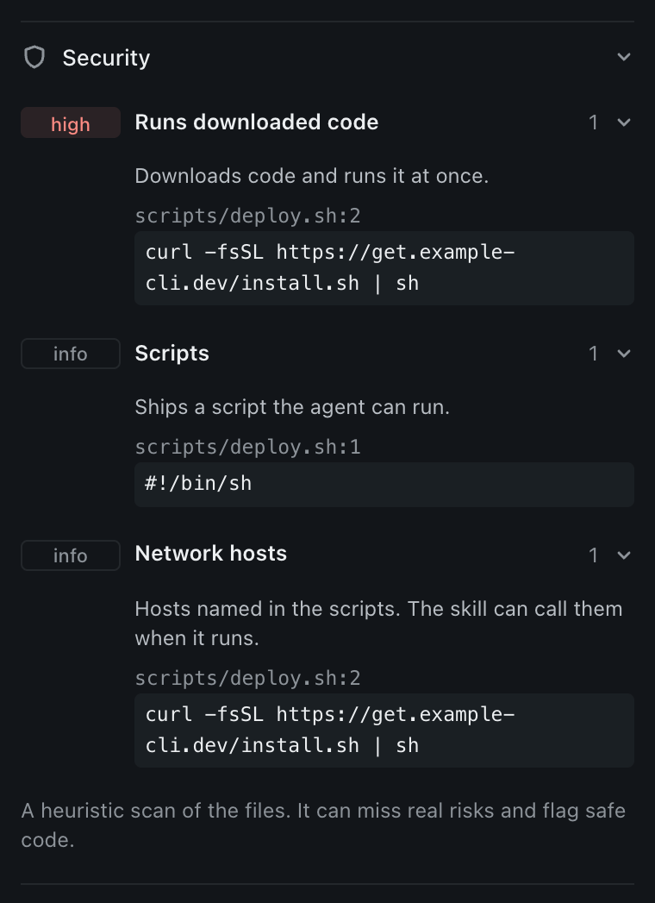</td><td width="50%" valign="top"><b>Find problems</b><br>The <b>Issues</b> view shows SKILL.md files with bad frontmatter, a wrong name, a long description, or links to files that are not there.<br><br>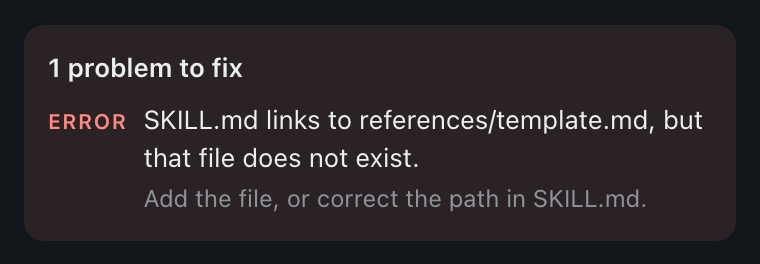</td></tr>
<tr><td colspan="2"><b>Act on many at once</b><br>Select skills, a range, or a whole source, then turn them on or off, update, copy, or delete them in one step.<br><br>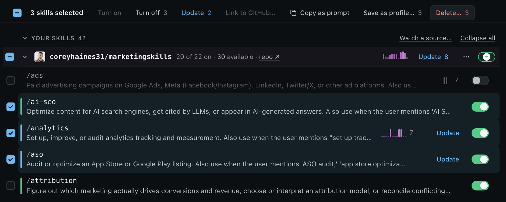</td></tr>
<tr><td width="50%" valign="top"><b>Profiles</b><br>Save the current switches as a named profile, and apply it later after a preview of each change.<br><br>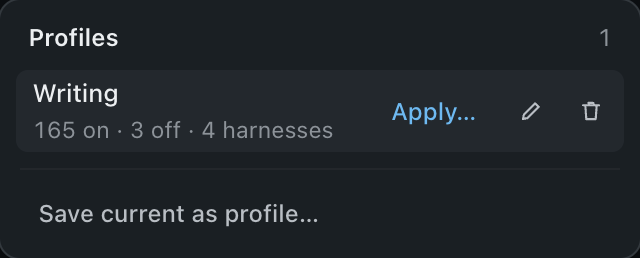</td><td width="50%" valign="top"><b>Move your set</b><br>Export your skills, sources, and switches to a file, and import it on another computer to get the same set.<br><br>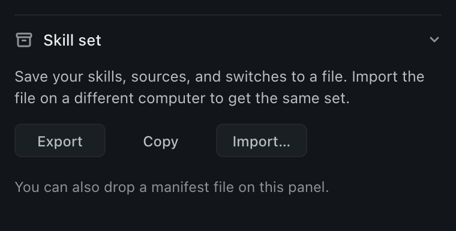</td></tr>
<tr><td width="50%" valign="top"><b>Make it yours</b><br>Pick rows or cards, a theme, one of five palettes, a quiet background texture, and the page size.<br><br>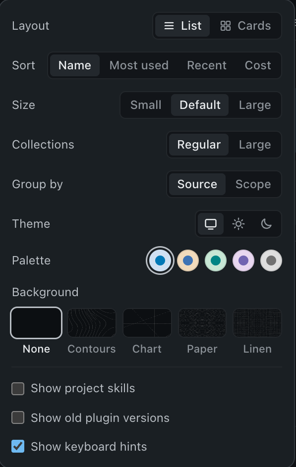</td><td width="50%" valign="top"><b>Small things</b><br>Find new skills in the repos you follow, see the avatar of each source, and delete to the Trash with Undo.</td></tr>
<tr><td colspan="2"><b>Read a skill</b><br>Press <kbd>v</kbd> to read the whole SKILL.md in a large reader, with an outline of its sections.<br><br>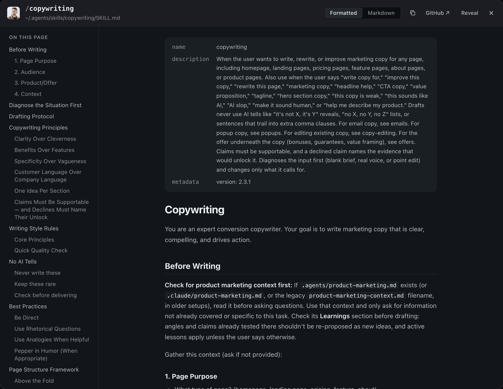</td></tr>
</table>

## How it works

**Sources.** A skill is tracked when it has a GitHub source in `~/.agents/.skill-lock.json`
(written by `npx skills`) or in `~/.agents/.atlas-lock.json` (written by **Link to GitHub…**).
Untracked skills that share a name prefix, such as `acme-*`, get their own group.

**Update checks.** On load, the atlas reads each source repo's file tree from GitHub (through `gh`,
then anonymous HTTPS). A skill is out of date when its folder SHA is different from the SHA in the
lock. Results stay in a cache for 10 minutes; **Check again** refreshes them.

**Updates and installs.** The atlas downloads one tarball per repo, swaps each skill folder through
a staged copy, and writes the new SHA back to the lock. `npx skills` stays in step.

**Local edits are safe.** A skill whose folder no longer matches its lock is tagged **edited**.
Batch updates skip it. Its own Update button asks first, because an update replaces the whole
folder.

**New skills.** The first check of a repo records a baseline. After that, skills added upstream
get a **new** tag. **Dismiss** clears the tag. **Watch a source…** follows a repo that has none of
its skills installed yet.

## Harnesses and switches

The picker at the top selects a harness. Each switch then changes that harness's own config. **All
harnesses** shows one dot per harness that loads a skill. The skill panel's **Loaded by** list has
a switch for each harness.

| Harness | Reads skills from | A switch writes |
| --- | --- | --- |
| Claude Code | `~/.claude/skills`, plugins | `skillOverrides` or `enabledPlugins` in `settings.json` |
| Codex | `~/.agents/skills`, `~/.codex/skills` | `[[skills.config]]` with `enabled = false` in `config.toml` |
| Gemini CLI | `~/.gemini/skills`, `~/.agents/skills` | `skills.disabled` in `settings.json` |
| Copilot CLI | `~/.copilot/skills`, `~/.agents/skills` | `disabledSkills` in `settings.json` |
| OpenCode | `~/.config/opencode/skills`, `~/.claude/skills`, `~/.agents/skills` | `permission.skill` in `opencode.json` |
| Cursor, Amp, Goose, Windsurf, Cline, Kiro, Roo Code, Antigravity | their own folders | no per-skill switch, so the atlas only lists them |

The atlas shows a harness when its home folder exists. A skill folder that several harnesses read
shows once. Installs, updates, and deletes act on `~/.agents/skills`, the folder `npx skills` uses.
Restart the harness's sessions to load a change.

## Keyboard

| Key | Action |
| --- | --- |
| `/` or `⌘K` | Search |
| `j` / `k` | Move between skills |
| `Enter` | Open the detail panel |
| `x` or `Space` | Turn the skill on or off |
| `u` | Update the skill |
| `i` | Install an available skill |
| `v` | Read the whole SKILL.md |
| `r` | Formatted or Markdown, in the reader |
| `g` | List or cards |
| `c` | Compact rows |
| `m` | Select the skill for bulk actions |
| `⌘A` | Select all skills shown |
| `⌘Z` | Undo the last change |
| `?` | All shortcuts |

## Configuration

No setup is needed. The atlas finds each harness in its usual folder, and also reads
`CLAUDE_CONFIG_DIR`, `CODEX_HOME`, and `COPILOT_HOME` when they are set.

To add project folders, or a second Claude Code config folder, run:

```bash
./atlas init
```

This writes `~/.config/skill-atlas/config.json` with the config folders it finds, and prints it.
Edit it to add `project_roots` or to rename a tab:

```json
{
  "config_roots": { "main": "~/.claude", "work": "~/.claude-work" },
  "harnesses": ["claude-code", "codex", "cursor"],
  "project_roots": ["~/code"],
  "project_scan_depth": 3
}
```

`config_roots` lists Claude Code config folders. `harnesses` is optional: it limits the picker to
these harnesses.

The atlas reads `$SKILL_ATLAS_CONFIG` first, then `~/.config/skill-atlas/config.json`, then a
`config.json` next to the code.

| Source | Where |
| --- | --- |
| Personal skills | Each harness's skill folders (see above). Symlinks are resolved, so a shared folder shows once. |
| Plugin skills | Claude Code: `<config root>/plugins/cache/<marketplace>/<plugin>/<version>/skills` |
| Project skills | `<project root>/**/.claude/skills` and `.agents/skills`, down to `project_scan_depth` |

Skills that ship inside a harness binary are not on disk, so the atlas cannot list them.

## Safety

- The server binds to `127.0.0.1` only. Each API call must send a token that changes every time
  the server starts, so other web pages cannot call it.
- In each harness config, the atlas changes only the skill keys in the table above and keeps the
  rest of the file. It makes a one-time backup (`settings.json.atlas-bak`, `config.toml.atlas-bak`)
  before the first write.
- Deletes go to the Trash (`~/.Trash` on macOS, the freedesktop Trash on Linux), never `rm`.
  Where there is no Trash, delete is not available.
- Plugin skills are not checked for updates.
- The page loads avatars, banners, and the SKILL.md of skills you have not installed straight
  from GitHub, so GitHub sees those requests.

## Without the server

```bash
PYTHONPATH=src python3 -m skill_atlas.build                        # write a read-only page to out/index.html
PYTHONPATH=src python3 -m skill_atlas.build --json > skills.json   # print the raw records
```

## Development

The tool uses only the Python standard library. Dev tools run through
[uv](https://docs.astral.sh/uv/):

```bash
uv run ruff check . && uv run ruff format --check . && uv run mypy && uv run pytest
```

Read [CONTRIBUTING.md](CONTRIBUTING.md) before you open a pull request.

## Credits

The interface follows the design engineering skills of [Emil Kowalski](https://emilkowal.ski). We
used them for most of the layout, motion, color, and polish decisions on this page.

## License

[MIT](LICENSE)
